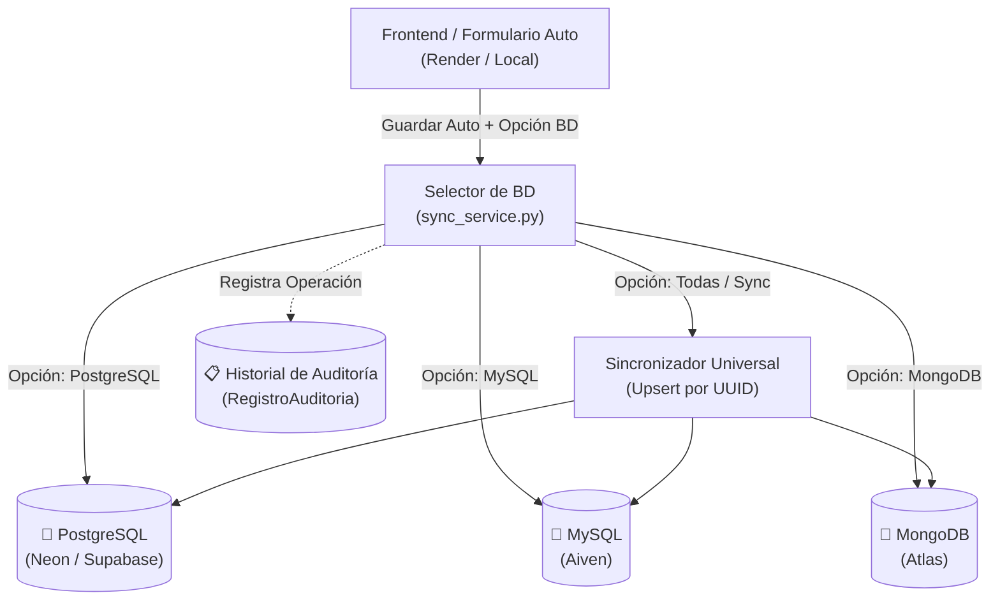

# Arquitectura Multi-Base de Datos: Deportivos Guadalupe
**Motores:** PostgreSQL + MySQL + MongoDB
**Entorno de despliegue:** Render / Cloud
**Autor:** Daniel Figueroa & AI Senior Dev Partner

---

## 1. Resumen del Objetivo
Migrar de una base de datos local SQLite a un ecosistema políglota en la nube donde:
1. Coexisten 3 motores de base de datos en la nube:
   - **PostgreSQL** (Neon.tech / Supabase / Render Postgres)
   - **MySQL** (Aiven.io / TiDB Cloud)
   - **MongoDB** (MongoDB Atlas)
2. Desde la interfaz de **Añadir / Editar Vehículo**, el usuario puede seleccionar a qué base de datos enviar el vehículo o si sincronizarlo en todas.
3. Existe un botón para **replicar / sincronizar** un auto existente hacia los otros dos motores.
4. Una pestaña dedicada de **Historial / Auditoría** que registra cada alta, edición y sincronización indicando el motor involucrado.

---

## 2. Diagrama de Flujo



---

## 3. Clave de la Solución Técnica

### A. La Llave Universal (`uuid`)
Cada vehículo tendrá un campo `uuid` (identificador único global). Esto permite saber que el *Porsche 911 GT3* con UUID `a3f8...` es el mismo objeto en MySQL, PostgreSQL y MongoDB, permitiendo hacer **Upserts** (actualizar si existe, insertar si no).

### B. Django ORM para PostgreSQL y MySQL
En `settings.py`:
```python
DATABASES = {
    'default': env.db('DATABASE_URL_SQLITE', default='sqlite:///db.sqlite3'),
    'postgres': dj_database_url.parse(env('DATABASE_URL_POSTGRES')),
    'mysql': dj_database_url.parse(env('DATABASE_URL_MYSQL')),
}
```
Para guardar en un motor relacional específico:
```python
vehiculo.save(using='postgres') # o using='mysql'
```

### C. Conexión nativa limpia con MongoDB (`pymongo`)
En lugar de instalar drivers que alteren el ORM de Django:
```python
from pymongo import MongoClient
import os

client = MongoClient(os.environ.get('MONGODB_URI'))
mongo_db = client['deportivos_guadalupe']

def guardar_en_mongo(vehiculo_dict):
    mongo_db.vehiculos.update_one(
        {'uuid': vehiculo_dict['uuid']},
        {'$set': vehiculo_dict},
        upsert=True
    )
```

---

## 4. Hoja de Ruta de Implementación (Roadmap)

### Fase 1: Creación de Cuentas y Credenciales Cloud (Gratis)
- **PostgreSQL:** Neon.tech (Plan Free, instantáneo).
- **MySQL:** Aiven.io (Plan Free Trial/Free tier).
- **MongoDB:** MongoDB Atlas (M0 Cluster gratuito).

### Fase 2: Configuración de Entorno (`settings.py` & `.env`)
- Instalar drivers: `psycopg2-binary`, `mysqlclient` (o `pymysql`), `pymongo`.
- Configurar las cadenas de conexión seguras.
- Correr migraciones en Postgres y MySQL:
  ```bash
  python manage.py migrate --database=postgres
  python manage.py migrate --database=mysql
  ```

### Fase 3: Módulo de Sincronización (`sync_service.py`)
- Crear servicio centralizado que gestione la escritura y replicación.

### Fase 4: Interfaz de Usuario
- Selector de Base de Datos en `car-create.html`.
- Botón "Sincronizar a todos los motores" en la ficha del vehículo (`car-showcase.html`).
- Pestaña y vista de "Historial de Cambios / Auditoría".
