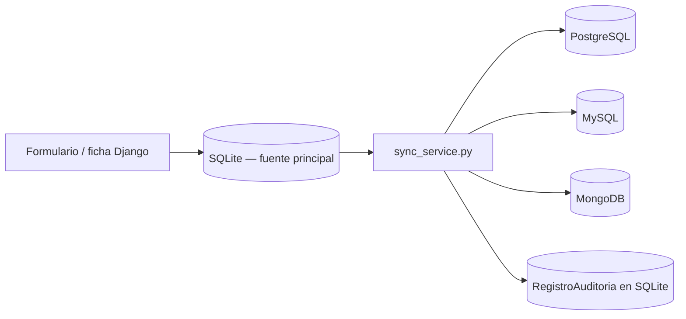

# Arquitectura Multi-Base de Datos: Deportivos Guadalupe

**Motores previstos:** SQLite local, PostgreSQL (Neon), MySQL (Aiven) y MongoDB Atlas
**Estado:** implementación parcial; todavía no está lista para dar por completada
**Proyecto Django:** `Deportivos_Guadalupe/`

## 1. Decisión arquitectónica actual

SQLite es la base principal y la fuente de datos que consulta la interfaz. PostgreSQL y MySQL son destinos relacionales de replicación; MongoDB es un destino documental. El formulario de vehículo permite elegir un destino y la ficha permite replicar un vehículo a los motores configurados. No hay lectura distribuida, failover ni sincronización bidireccional.

La clave `uuid` de `Vehiculo` se usa para hacer upsert en los destinos. Las imágenes adicionales se copian como URL y MongoDB guarda un documento serializado del vehículo. Los archivos multimedia no se transfieren a los servicios cloud: se copian sus valores/rutas actuales, por lo que su disponibilidad fuera del servidor local debe resolverse aparte.



## 2. Qué está implementado

- `Vehiculo.uuid` y el modelo `RegistroAuditoria`; migración de la aplicación hasta `0009`.
- Configuración opcional de `postgres`, `mysql` y MongoDB mediante variables de entorno.
- `sync_service.py`: serialización, consulta de disponibilidad, upsert relacional por UUID, escritura en MongoDB y replicación.
- Vistas/formularios para elegir destino, replicar un vehículo y consultar historial.
- Los logs de la sesión anterior reportan `manage.py check` correcto y 15 pruebas correctas. En la comprobación más reciente, `showmigrations` funcionó; la suite actual ejecutó 15 pruebas y falló una porque el entorno tiene bases remotas configuradas y una prueba esperaba que no hubiera destinos remotos. Esa falla no demuestra que la migración de PostgreSQL haya fallado de nuevo.

## 3. Bloqueos conocidos (punto donde se detuvo el trabajo)

### 3.1 Migración de PostgreSQL: corrección del alias de conexión aplicada

El intento anterior de `migrate --database=postgres` terminó con `IntegrityError` en `fecha_publicacion`. En ese momento `seed_vehicles()` usaba `Vehiculo.objects.create(...)` sin seleccionar la conexión de la migración. Al preparar una base secundaria, eso podía escribir por defecto en SQLite, cuyo esquema ya era posterior al esquema histórico de `0003`.

La corrección ya está aplicada en `0003_vehiculo.py`: la migración obtiene la conexión que Django está usando mediante `schema_editor.connection.alias` y guarda los vehículos de ejemplo usando esa misma conexión. No se añadieron conexiones nuevas ni se sustituyó el modelo histórico por el modelo actual.

Editar el archivo, por sí solo, no confirmaba que la migración hubiera terminado en PostgreSQL; por eso se revisó el estado antes de continuar. No borrar ni recrear bases para “arreglar” el estado.

El usuario informa que Neon había pausado su proyecto por inactividad y que ya lo encendió. Eso puede explicar errores temporales de conexión a PostgreSQL, pero es distinto del `IntegrityError` de `fecha_publicacion` registrado en los logs: ese error se debía a que la migración escribía en SQLite en vez de en la conexión de PostgreSQL.

Estado actualizado después de la autorización del usuario: se ejecutó `migrate --database=postgres` y Django aplicó `0003`–`0009` correctamente, además de migraciones pendientes de `auth`, `contenttypes` y `sessions`. Una nueva comprobación con `showmigrations --database=postgres` muestra todas las migraciones de esta aplicación (`0001`–`0009`) aplicadas. SQLite (`default`) también conserva `0001`–`0009` aplicadas. No se ejecutaron migraciones en MySQL.

### 3.2 MySQL en Aiven: conectividad verificada

Los logs anteriores mostraban `getaddrinfo failed`, pero una comprobación posterior desde el entorno del proyecto resolvió el host DNS de MySQL y ejecutó `SELECT 1` correctamente. Por tanto, el error de DNS **no persiste en este momento** y el servidor acepta conexiones desde este entorno. La consulta fue de solo lectura; no se ejecutaron migraciones ni escrituras en MySQL.

**Siguiente paso:** revisar el estado de migraciones en MySQL y, antes de aplicarlas, confirmar el destino y tener respaldo. Mantener TLS habilitado; no desactivar la seguridad de la conexión.

### 3.3 Comportamiento de resultado parcial

`save_vehicle_with_route()` guarda primero en SQLite. Para una selección de motor remoto, informa éxito o error de ese destino. En cambio, al elegir `all`, devuelve `status: success` aunque `replicate_vehicle_to_all()` pueda haber fallado en uno o más destinos. Las vistas de alta/edición pueden por ello mostrar un mensaje de éxito engañoso.

**Siguiente cambio de código:** derivar el estado global de `results` (todos correctos, parciales, todos fallidos o ningún motor remoto configurado) y propagarlo a la vista. Conservar siempre que el vehículo ya quedó guardado en SQLite, aunque falle la replicación, y mostrar claramente los motores que fallaron.

## 4. Continuación recomendada para un developer junior

1. **Acordar qué significa “público”.** Una página o una base accesible desde Internet no necesita que su contraseña se publique. Si el proyecto académico decide deliberadamente compartir credenciales, usar únicamente datos de demostración y limitar los permisos de esa cuenta; alguien con permisos de escritura podría cambiar o borrar esos datos y consumir recursos del servicio. No reutilizar credenciales de otras cuentas.
2. **PostgreSQL completado.** La migración `0003_vehiculo.py` se corrigió para usar la conexión activa; luego se aplicaron las migraciones pendientes de PostgreSQL con autorización y respaldo confirmado. La verificación posterior muestra `0001`–`0009` aplicadas. No añadir imports ni crear conexiones manuales.
3. **MySQL accesible.** La prueba más reciente confirmó que DNS resuelve y que Aiven responde `SELECT 1`. La conexión funciona ahora desde este entorno.
4. **Completar la semántica de errores parciales.** Ajustar el resultado de la opción `all` y asegurar que la auditoría/mensajes coincidan con los resultados reales de cada motor.
5. **Preparar el esquema de MySQL.** No se han ejecutado migraciones en Aiven. Tras confirmar el estado de migración, el destino y el respaldo, aplicar las pendientes con `python manage.py migrate --database=mysql`. MongoDB no usa migraciones Django; la colección se crea al escribir.
6. **Validar de forma acotada.** Tras los cambios de código, ejecutar `python manage.py check` y `python manage.py test app_deportivos_guadalupe`. En la ejecución más reciente, 14 de 15 pruebas pasaron; la restante espera que no haya bases remotas configuradas, pero el `.env` actual sí configura PostgreSQL/MySQL. Ajustar el aislamiento de esa prueba antes de considerarla validación final. Luego probar una escritura por destino y una replicación parcial solo en entornos de prueba o con autorización.

## 5. Configuración

`settings.py` carga `.env`, `.env.deportivos_guadalupe` y las variantes ubicadas en el directorio padre. Las variables esperadas (sin valores reales) están en `Deportivos_Guadalupe/.env.example`:

```dotenv
DATABASE_URL_POSTGRES=
DATABASE_URL_MYSQL=
MONGODB_URI=
MONGODB_NAME=deportivos_guadalupe
```

No es obligatorio configurar todos los motores para levantar la aplicación; los motores remotos ausentes o inaccesibles deben mostrarse como no disponibles. La pantalla de historial y el registro de auditoría usan actualmente SQLite.

## 6. Alcance pendiente para considerar la tarea terminada

- Migraciones aplicadas correctamente a las bases relacionales que se vayan a usar.
- Los motores que se decida usar están accesibles desde el entorno de ejecución; las credenciales tienen los permisos adecuados para el nivel de publicación elegido.
- Mensajería y auditoría correctas para éxito total, parcial y fallo total.
- Definir y documentar una política para los archivos multimedia y para los cuatro vehículos de ejemplo insertados por la migración inicial en cada base relacional.
- Validación final en entornos de prueba, seguida de despliegue controlado. No ejecutar migraciones remotas automáticamente como parte del build de Render hasta entender y aprobar su impacto.

------------------------------------------------------------------------------------------------------------------------------------------------------------------------------------------------------------------------------------------------------------------------------------------------------------------------------------------------------------------------------------------------------------------------------------------------
------------------------------------------------------------------------------------------------------------------------------------------------------------------------------------------------------------------------------------------------------------------------------------------------------------------------------------------------------------------------------------------------------------------------------------------------
------------------------------------------------------------------------------------------------------------------------------------------------------------------------------------------------------------------------------------------------------------------------------------------------------------------------------------------------------------------------------------------------------------------------------------------------

# EXPLICACION EN LENGUAJE PATATA

Esta parte está escrita para alguien que no programa. No necesitas entender el código para seguir los pasos de seguridad y revisar el estado de las cuentas. Cuando un paso diga **“hace falta una persona técnica”**, no intentes adivinar ni pegar comandos: comparte ese paso con un desarrollador.

## La idea, sin palabras raras

Imagina que SQLite es el cuaderno principal donde trabaja la aplicación. PostgreSQL, MySQL y MongoDB son otros tres cuadernos en la nube. El proyecto ya tiene parte del mecanismo para copiar la ficha de un vehículo del cuaderno principal a los otros.

La página web y el historial ya existen, pero aún hay problemas que impiden confirmar que las copias funcionan correctamente:

- PostgreSQL tropezó al preparar sus tablas.
- MySQL no pudo encontrar su servidor en Internet.
- Si se intenta copiar a todas las bases, la aplicación podría decir “éxito” aunque alguna copia haya fallado.

Por eso, **no significa que todo el trabajo esté perdido**; significa que hay que resolver esos puntos antes de confiarle datos reales.

## Paso 1: proteger las claves que aparecieron en los logs

En el texto de la terminal compartido aparecían datos secretos de conexión. Piensa en ellos como contraseñas de las bases de datos.

1. Decide si quieres que sea pública la **página del proyecto** o también las **claves que permiten entrar a las bases**. Son cosas distintas: una página puede estar disponible para los instructores sin compartir la contraseña de PostgreSQL, MySQL o MongoDB.
2. Si solo quieres que los instructores revisen la aplicación, comparte la dirección de la página; no hace falta publicar contraseñas de las bases.
3. Si, por el objetivo académico, decides que las claves de la base también sean públicas, entiende y acepta que otra persona podría modificar o borrar los datos y consumir los límites gratuitos del servicio. Hazlo únicamente con datos de demostración, sin información personal, y con permisos lo más limitados posible.
4. No compartas una contraseña que también uses en otros servicios. Si ya publicaste una clave que no debía ser pública, o que tiene acceso a datos importantes, pide ayuda para reemplazarla y actualizar la configuración del proyecto.
5. La `SECRET_KEY` de Django es otra clave distinta. No se necesita compartirla para que los instructores revisen la página; si se publicó, pide a una persona técnica que evalúe cambiarla.

## Paso 2: no borrar ni “reiniciar” las bases

Mientras se investiga:

- No pulses botones como **Delete**, **Reset**, **Destroy**, **Recreate** o equivalentes en los paneles de las bases.
- No borres archivos `.env` ni bases de datos.
- No ejecutes instrucciones que incluyan `migrate`, a menos que una persona técnica haya confirmado el destino, el estado actual y que existe respaldo.
- No compartas el contenido de archivos `.env`: suelen contener contraseñas.

Estos cuidados evitan perder datos o modificar una base que sí esté en uso.

## Paso 3: comprobar qué servicio estaba apagado

El usuario confirmó que Neon, que aloja PostgreSQL, se había pausado por inactividad y que ahora está encendido. Eso puede explicar errores de conexión mientras estaba pausado. Si vuelve a ocurrir, revisar el estado del proyecto en Neon y esperar a que esté activo antes de probar otra vez.

**Estado actual de MySQL:** aunque el log antiguo tenía un error de DNS, la comprobación más reciente resolvió el host y obtuvo respuesta del servidor. No parece necesario corregir el hostname ahora. El panel de Aiven sigue siendo útil para revisar servicio y datos de conexión si el error reaparece:

Este paso solo requiere revisar el panel web de Aiven; no requiere programar.

1. Entra a Aiven con tu cuenta.
2. Abre el servicio de MySQL que corresponde a este proyecto.
3. Mira si el estado aparece como activo/encendido. Si está detenido, sigue las indicaciones del panel o contacta al soporte; no borres el servicio para intentar arreglarlo.
4. Si aparece activo, busca la sección de información de conexión. Comprueba que muestra un host, un puerto, un usuario y una base de datos.
5. Si el panel muestra que está activo, pero el proyecto vuelve a fallar, una persona técnica puede repetir una comprobación de DNS y conexión desde el mismo entorno donde se ejecuta Django.

El error anotado fue parecido a “no puedo encontrar la dirección del servidor”. Eso es como escribir una dirección que el navegador no logra localizar: cambiar la contraseña por sí solo no arregla necesariamente el problema. **No desactives la seguridad SSL/TLS** para intentar que conecte.

## Paso 4: entender la corrección de PostgreSQL

No faltaba importar una conexión ni crearla a mano. Django ya conoce las conexiones desde su configuración. El problema era que la migración guardaba los autos de ejemplo en la base predeterminada (SQLite), aunque se estaba intentando preparar PostgreSQL.

**La corrección ya se hizo** en `Deportivos_Guadalupe/app_deportivos_guadalupe/migrations/0003_vehiculo.py`: ahora la tarea pregunta a Django qué conexión está usando y guarda los datos allí. En lenguaje de código, usa `schema_editor.connection.alias` y `.using(database_alias)`.

Esto corrige el código para próximas ejecuciones de esa migración, pero no ejecuta la migración por sí solo. Después de confirmar respaldo, el usuario autorizó preparar PostgreSQL; la operación terminó correctamente. `showmigrations` ahora muestra las nueve migraciones de la aplicación aplicadas tanto en SQLite como en PostgreSQL. No hizo falta importar ni crear conexiones manuales.

La suite local de pruebas también se ejecutó: 14 de 15 pasaron. La restante esperaba que no hubiera bases remotas configuradas, aunque el proyecto sí las tiene configuradas en este entorno. Esa prueba debe aislarse de la configuración real de las bases; no cambies credenciales ni agregues las bases reales al entorno de pruebas para hacerla pasar.

## Paso 5: pedir que arreglen el mensaje de “éxito”

La aplicación guarda primero el vehículo en SQLite y después intenta hacer las copias. Si una copia falla, el vehículo local puede seguir guardado; eso no quiere decir que todas las copias estén hechas.

Pídele al desarrollador:

> Cuando se elige “todas las bases”, que el mensaje diga claramente si todas recibieron el vehículo, si solo algunas lo recibieron o si ninguna copia remota funcionó. El historial debe mostrar lo mismo que pasó. No debe decir “éxito total” cuando hubo fallos.

## Paso 6: cuándo se pueden hacer las pruebas

Las pruebas contra servicios de Internet pueden modificar datos, así que primero hay que confirmar que se está usando un entorno de prueba o que tienes permiso para cambiar esas bases.

Una persona técnica debe hacer este orden para completar lo que todavía falta:

1. Confirmar que la política de acceso público está decidida y que solo se usan datos de demostración; si las claves no deben ser públicas, guardarlas de forma privada.
2. PostgreSQL ya está migrado; revisar por separado si MySQL (Aiven) está activo y accesible.
3. Corregir el mensaje de resultado parcial.
4. Hacer primero las comprobaciones automáticas del proyecto y después una prueba pequeña de guardar/copiar un vehículo de prueba.
5. Revisar que el vehículo de prueba aparezca donde debía y que el historial indique con honestidad qué bases lo recibieron.

Las comprobaciones automáticas mencionadas en los logs anteriores salieron bien en ese momento, pero **no prueban** que las bases remotas ya estén preparadas o que MySQL ahora sea accesible.

## Si un desarrollador te pide ejecutar comprobaciones locales

Solo si la persona técnica te dice que ejecutes las comprobaciones locales (no las migraciones), abre PowerShell en la carpeta principal del proyecto `riderrr` y ejecuta:

```powershell
& ".\.venv\Scripts\python.exe" .\kiflom\Deportivos_Guadalupe\manage.py check
& ".\.venv\Scripts\python.exe" .\kiflom\Deportivos_Guadalupe\manage.py test app_deportivos_guadalupe
```

Estos comandos revisan el proyecto y sus pruebas; no son los comandos para preparar las bases de datos remotas. Si PowerShell dice que no encuentra un archivo o una carpeta, detente y comparte **solo el mensaje de error**, ocultando cualquier contraseña, URL privada o clave.

## ¿Cómo sabré que ya terminó?

Pide a la persona técnica que confirme todos estos puntos:

- [ ] Las claves antiguas expuestas fueron cambiadas y las nuevas se guardaron en privado.
- [ ] PostgreSQL terminó de preparar sus tablas sin error.
- [ ] MySQL aparece accesible desde el mismo entorno donde corre la aplicación.
- [ ] Una prueba de vehículo se copió correctamente a cada base que se decidió usar.
- [ ] Si una base falla, la aplicación lo dice claramente y no afirma que todo salió bien.
- [ ] El historial muestra el resultado real de la prueba.

Hasta tener esa confirmación, lo más seguro es considerar Multi-BD **en progreso**, no terminado.
